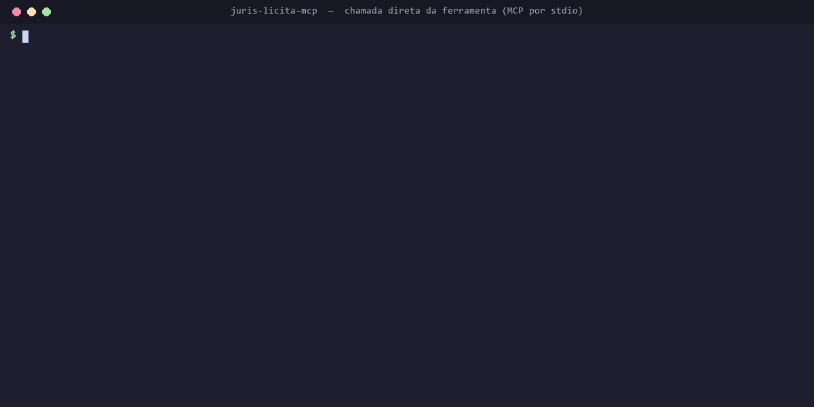

# Juris Licita MCP

> **English summary.** `juris-licita-mcp` is an open-source [Model Context Protocol](https://modelcontextprotocol.io) server for Brazilian **lawyers and public-procurement bidders**. One line: `npx juris-licita-mcp`. Free and keyless: procedural deadlines with court holidays per court and district (CPC, CLT, DJEN publication rules, electronic summons, doubled deadlines, year-end recess) with the source of every skipped day, a catalog of statutory deadlines, business-day math, official Central Bank indices with inflation adjustment, open tenders from PNCP, CPF/CNPJ checksum validation (local), ZIP code and basic company data. Advanced tools (DJEN court publications by bar number, lawsuits, AI tender analysis, buyer score, lawyer lookup, real estate) proxy to the BitBusca remote MCP and need a `BITBUSCA_API_KEY` (free test key with fictitious data). No personal data, no telemetry. MIT licensed. Docs below are in Portuguese.

**Prazos com feriado forense da comarca, editais abertos e correção monetária, direto no Claude, no Cursor ou no VS Code.** Para quem advoga e para quem licita. Uma linha para instalar, sem cadastro, sem chave.



<sub>Chamada direta da ferramenta `contar_dias_uteis` pelo protocolo MCP (stdio), sem cliente de IA no meio, com o
script [`docs/demo-chamada.mjs`](docs/demo-chamada.mjs). No Claude, no Cursor ou no VS Code a resposta é a mesma.
Gravado com a versão 0.1.0; a saída é a real da ferramenta.</sub>

```bash
npx juris-licita-mcp
```

[](https://github.com/bitbusca/juris-licita-mcp/actions/workflows/ci.yml)


---

## O que dá para perguntar

**Advocacia**

- "Saiu intimação no DJEN em 13/11/2026 para um processo do TJMS em Campo Grande. Prazo de 15 dias úteis: quando vence? Mostre os dias que não contaram."
- "Qual o prazo da contestação no CPC? E do recurso ordinário na CLT?"
- "A Fazenda foi intimada eletronicamente em 02/03/2026 e não abriu. Prazo de 15 dias em dobro: quando vence?"
- "Quais os feriados forenses do TRT24 em dezembro?"
- "Corrija R$ 25.000 de março de 2021 até hoje pelo IPCA-E, ano a ano."

**Licitações**

- "Tem pregão eletrônico aberto de merenda escolar em Mato Grosso do Sul? Quais encerram até sexta?"
- "Liste os editais abertos em Campo Grande (IBGE 5002704) publicados mais recentemente."
- "O prazo de impugnação é de 3 dias úteis antes da abertura em 24/11/2026. Até quando posso impugnar?"
- "Esse CNPJ é válido? 12.ABC.345/01DE-35" (sim, o CNPJ alfanumérico de 2026)
- "Situação, CNAE e porte do CNPJ 11.222.333/0001-81."

Com a chave da BitBusca (modo avançado):

- "Quais intimações saíram para a OAB 123456/SP esta semana? Resuma a mais recente e calcule o prazo."
- "Monte a ficha do processo 0000000-00.2026.8.12.0001."
- "Ache editais de limpeza hospitalar acima de R$ 500 mil e analise o primeiro: que documentos preciso juntar?"

## Instalação

Precisa do [Node.js 20 ou mais novo](https://nodejs.org). Nada mais.

### Claude Code

```bash
claude mcp add juris-licita -- npx -y juris-licita-mcp
```

Com o modo avançado:

```bash
claude mcp add juris-licita -e BITBUSCA_API_KEY=bk_test_SUA_CHAVE -- npx -y juris-licita-mcp
```

Use `--scope user` para ter em todos os projetos.

### Claude Desktop

Em *Configurações → Desenvolvedor → Editar configuração* (`claude_desktop_config.json`):

```json
{
  "mcpServers": {
    "juris-licita": {
      "command": "npx",
      "args": ["-y", "juris-licita-mcp"],
      "env": { "BITBUSCA_API_KEY": "" }
    }
  }
}
```

Deixe `BITBUSCA_API_KEY` vazio para usar só o grátis. Reinicie o Claude Desktop.

> **Windows:** se o Claude Desktop não achar o `npx`, use `"command": "cmd"` e `"args": ["/c", "npx", "-y", "juris-licita-mcp"]`.

### Cursor

Arquivo `~/.cursor/mcp.json` (global) ou `.cursor/mcp.json` (no projeto):

```json
{
  "mcpServers": {
    "juris-licita": {
      "command": "npx",
      "args": ["-y", "juris-licita-mcp"],
      "env": { "BITBUSCA_API_KEY": "" }
    }
  }
}
```

### VS Code (Copilot Chat, modo agente)

Arquivo `.vscode/mcp.json`. O VS Code pergunta a chave na primeira vez e guarda com segurança (pode deixar em branco):

```json
{
  "inputs": [
    { "type": "promptString", "id": "bitbusca-key", "description": "Chave BitBusca (opcional, liga o modo avançado)", "password": true }
  ],
  "servers": {
    "juris-licita": {
      "type": "stdio",
      "command": "npx",
      "args": ["-y", "juris-licita-mcp"],
      "env": { "BITBUSCA_API_KEY": "${input:bitbusca-key}" }
    }
  }
}
```

### Qualquer outro cliente MCP (HTTP)

```bash
npx juris-licita-mcp --http            # http://127.0.0.1:3333/mcp (Streamable HTTP, sem sessão)
npx juris-licita-mcp --http --port 8080
```

No modo HTTP, o cabeçalho `Authorization: Bearer bk_…` de cada pedido vale como a chave daquele pedido. Por padrão ouve só em `127.0.0.1`, com proteção contra DNS rebinding e limite de 60 chamadas por minuto por IP. Se for expor na internet, ponha um proxy com TLS na frente.

## Grátis × avançado

| Ferramenta | O que faz | Grátis, sem chave | Fonte |
|---|---|:---:|---|
| `calcular_prazo` | Vencimento do prazo processual com passo a passo: CPC, CLT, corridos, **DJEN** (disponibilização → publicação), intimação eletrônica com ciência ficta, prazo em dobro, recesso, **feriados forenses do tribunal e municipais da comarca**, cada dia pulado com a fonte | sim | [prazos-br](https://github.com/bitbusca/prazos-br) (local) |
| `prazos_da_lei` | Quantos dias tem um ato (contestação, apelação, embargos…), como conta e a base legal | sim | catálogo do prazos-br |
| `feriados` | Feriados nacionais (com a lei) ou o calendário forense completo de um tribunal/comarca | sim | prazos-br |
| `contar_dias_uteis` / `somar_dias_uteis` | Dias úteis no calendário forense, nacional ou bancário, com os dias que não contaram e por quê | sim | prazos-br |
| `tribunais_cobertos` | Quais tribunais têm calendário forense completo e para quais anos | sim | prazos-br |
| `indice_economico` | SELIC (diária e meta), CDI, IPCA, IPCA-E, INPC, IGP-M, dólar; acumulado no período e em 12 meses | sim | Banco Central (SGS, API pública) |
| `corrigir_valor` | Correção monetária simples por IPCA, IPCA-E, INPC, IGP-M ou SELIC, na convenção da Calculadora do Cidadão | sim | Banco Central (SGS) |
| `editais_abertos` | Licitações com proposta aberta: palavras, UF, município (IBGE), modalidade, prazo, link | sim | PNCP (busca pública) |
| `validar_documento` | Dígito verificador de CPF e CNPJ (inclui o **CNPJ alfanumérico** de 2026). Local, não consulta ninguém; CPF volta mascarado | sim | cálculo local |
| `consultar_cep` | Endereço do CEP | sim, com cota diária* | BitBusca |
| `consultar_cnpj` | Cadastro público do CNPJ (situação, CNAE, porte, endereço, Simples/MEI), sem sócios | sim, com cota diária* | BitBusca (dados públicos da Receita) |
| `buscar_publicacoes_djen`, `ler_publicacao` | Intimações e publicações do Diário de Justiça Eletrônico Nacional por OAB, processo, parte ou palavras | chave | BitBusca |
| `criar_monitor_djen` | Avisa (webhook) a cada publicação nova de uma OAB, parte ou processo | chave | BitBusca |
| `ficha_processo` | Capa e movimentações do processo | chave | BitBusca |
| `ficha_advogado` | Ficha pública do advogado pela OAB, sem contatos | chave | BitBusca |
| `buscar_editais_bitbusca`, `ler_edital` | Editais do PNCP e de outros portais, com filtro de valor e prazo | chave | BitBusca |
| `analisar_edital`, `resumo_edital` | O **Bitinho** lê o edital: checklist de documentos, prazos, riscos, cada item com a página de onde saiu | chave (mostra o custo antes) | BitBusca |
| `score_orgao` | Nota de 0 a 100 do órgão comprador (o órgão costuma pagar em dia?), por regra sobre dados fiscais públicos, com as razões e a fonte de cada uma | chave (1 crédito; falha técnica não cobra) | BitBusca (Tesouro Nacional, Portal da Transparência, PNCP) |
| `buscar_empresas` | Empresas por UF, município, CNAE, porte e abertura, sem sócios | chave | BitBusca |
| `cidades_imovel`, `buscar_imovel`, `ficha_imovel` | Cadastro imobiliário municipal (cidades com cobertura), sem proprietário | chave | BitBusca |
| `meu_saldo` | Plano e saldo de créditos | chave | BitBusca |

\* Sem chave, CEP e CNPJ usam a consulta pública da BitBusca, com cota por conexão: 300 CEPs e 50 CNPJs diferentes por dia. O CNPJ vem só da base própria (cadastro público da Receita), sem sócios, telefone ou e-mail; no MEI e no empresário individual, o endereço sai só com bairro, cidade e UF. Consultas de CNPJ em sequência (raiz +1, +2…) pausam a consulta sem chave daquela conexão por 24 horas. Quando a cota acaba, a ferramenta diz isso e, se houver chave, segue por ela (com a chave, CEP é grátis e CNPJ custa 1 crédito).

Sem chave, toda ferramenta avançada responde normalmente dizendo o que faria e como ligar. Nada quebra.

### Cobertura dos calendários forenses

O calendário forense completo (portarias do ano, feriados municipais por comarca, pontos facultativos, recesso) existe hoje para **TJMS** (56 comarcas, anos de 2021 a 2026 conferidos) e **TRT24** (22 cidades, 2026 conferido). Nos demais tribunais o cálculo usa os feriados nacionais, o recesso e a suspensão de 20/12 a 20/01 (CPC art. 220), e **avisa na resposta** que o vencimento real pode ser posterior. Outros tribunais em breve; o formato é aberto e aceita contribuição no [prazos-br](https://github.com/bitbusca/prazos-br/blob/main/CONTRIBUTING.md). Pergunte à IA "quais tribunais estão cobertos?" para ver a lista atual.

## Modo avançado (chave BitBusca)

1. Crie a chave em **[bitbusca.net/desenvolvedor](https://bitbusca.net/desenvolvedor?utm_source=github&utm_medium=juris-licita-mcp&utm_content=readme)**.
   - **Chave de teste** (`bk_test_…`): grátis, sem prazo, devolve **dados fictícios**. Boa para montar e testar.
   - **Sandbox**: 7 dias com créditos de cortesia, dados reais.
   - **Planos**: créditos mensais; veja em [bitbusca.net/desenvolvedores](https://bitbusca.net/desenvolvedores?utm_source=github&utm_medium=juris-licita-mcp&utm_content=readme).
2. Ponha a chave em `BITBUSCA_API_KEY` na configuração do MCP e reinicie o app de IA.

As ferramentas avançadas repassam a chamada ao MCP oficial da BitBusca no perfil **Empresas** (`https://api.bitbusca.net/api/v1/mcp/empresas`), o mesmo dos diretórios de conectores: sem pessoa física como resultado principal, credencial só no cabeçalho.

**Como a cobrança funciona**

- **Falha técnica não cobra; "nada consta" cobra.** Se a consulta não saiu por erro nosso ou da fonte, nenhum crédito é gasto. Se saiu e não havia registro, isso é resposta (a base foi consultada) e custa o mesmo.
- **Análises por IA mostram o custo antes.** `analisar_edital` e `resumo_edital` chamadas sem `confirmar` devolvem só o custo em créditos, o saldo e se você já pagou por aquela análise (grátis). Só com `confirmar: true` executam e cobram, uma vez por edital a cada 30 dias.
- A chave de teste nunca cobra.

## Privacidade e regras

- **Nenhum dado de pessoa física nas ferramentas grátis.** `validar_documento` só confere a matemática do número. `consultar_cnpj` não traz sócios, telefone nem e-mail; no MEI e no empresário individual o endereço sai só com bairro, cidade e UF; sequência com cara de CPF dentro de texto vira `***.***.***-**`. As avançadas usam o perfil Empresas, que filtra pessoa física do lado do servidor (publicações judiciais trazem os nomes como saíram no diário oficial).
- **Sem telemetria.** O servidor não conta uso nem envia nada a lugar nenhum além da fonte que a ferramenta chamada precisa (Banco Central, PNCP ou BitBusca). Prazos, feriados e validação rodam 100% na sua máquina. Não existe nada para desligar porque nada é coletado. As chamadas levam o `User-Agent: juris-licita-mcp/<versão>`, para a fonte saber quem é.
- **Educação com as fontes públicas.** Cache em memória (índices: 6 h; editais: 10 min; CEP/CNPJ: até 24 h), uma chamada por vez por fonte com intervalo mínimo, recuo em `429` respeitando `Retry-After`. Nada de varredura.
- **Mensagens de erro simples.** Sem pilha, sem detalhe técnico. Para diagnosticar na sua máquina, rode com `JURIS_LICITA_MCP_DEBUG=1` (vai só para o stderr local).

## Variáveis de ambiente

| Variável | Padrão | Para quê |
|---|---|---|
| `BITBUSCA_API_KEY` | (vazia) | Liga o modo avançado |
| `BITBUSCA_API_URL` | `https://api.bitbusca.net/api` | Base da API (CEP/CNPJ) |
| `BITBUSCA_MCP_URL` | `…/v1/mcp/empresas` | MCP remoto do modo avançado |
| `JURIS_LICITA_MCP_HTTP_HOST` / `JURIS_LICITA_MCP_HTTP_PORT` | `127.0.0.1` / `3333` | Modo `--http` |
| `JURIS_LICITA_MCP_DEBUG` | (vazia) | Diagnóstico no stderr |

## Cuidados

- **Prazo é cálculo auxiliar.** Confira sempre no processo; não substitui a conferência profissional. Portarias mudam durante o ano (suspensão por falha de sistema, ponto facultativo novo): a resposta avisa quando o tribunal, a comarca ou o ano não estão cadastrados.
- A correção monetária é **simples** (sem juros, multa nem honorários) e serve de conferência. Para cálculo judicial completo com memória em PDF: [bitbusca.net/calculos](https://bitbusca.net/calculos?utm_source=github&utm_medium=juris-licita-mcp&utm_content=readme).
- Os dados vêm das fontes oficiais na hora da consulta; a fonte é citada em cada resposta.

## Projetos irmãos

- **[prazos-br](https://github.com/bitbusca/prazos-br)**: a biblioteca de prazos e calendários forenses usada aqui (TypeScript, MIT). Use direto no seu sistema.
- **[mcp-brasil](https://github.com/Mcp-Brasil/mcp-brasil)**: para dados públicos gerais do Brasil, o mcp-brasil reúne dezenas de APIs públicas num servidor só e é um ótimo complemento. Os dois rodam lado a lado: ele cobre o amplo; o Juris Licita MCP é especializado em prazo processual, DJEN e licitação.

## Desenvolvimento

```bash
git clone https://github.com/bitbusca/juris-licita-mcp && cd juris-licita-mcp
npm install
npm run build
npm test                 # node:test, sem rede (fixtures e mocks)
npm run inspector        # MCP Inspector apontando para dist/index.js
```

Testar no Claude Code sem publicar:

```bash
claude mcp add juris-licita-local -- node /caminho/para/juris-licita-mcp/dist/index.js
```

Estrutura: `src/ferramentas/` (uma por assunto), `src/servidor.ts` (registro das ferramentas), `src/index.ts` (stdio e HTTP), `test/` (testes com fixtures reais recortadas em `test/fixtures/`).

Contribuições são bem-vindas: abra uma issue antes de mudanças grandes. Calendário de tribunal novo vai no [prazos-br](https://github.com/bitbusca/prazos-br/blob/main/CONTRIBUTING.md); ferramenta grátis nova (sempre de dado público e sem pessoa física) vem para cá.

## Licença

[MIT](LICENSE). Feito pela [BitBusca](https://bitbusca.net?utm_source=github&utm_medium=juris-licita-mcp&utm_content=readme).
